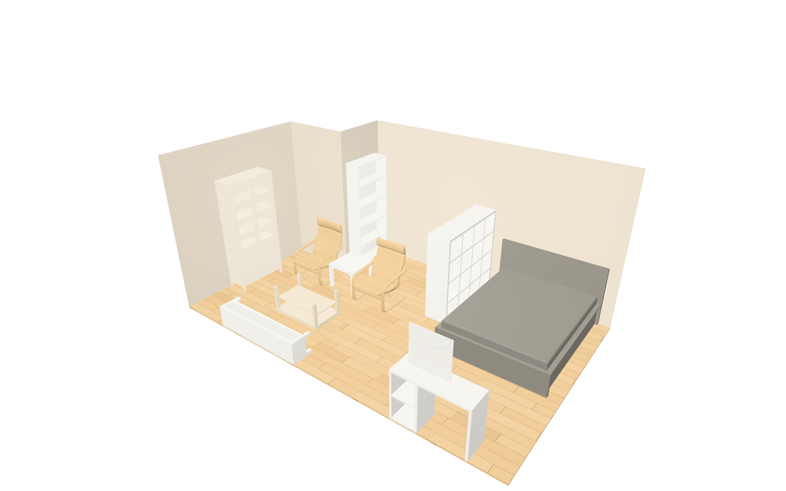
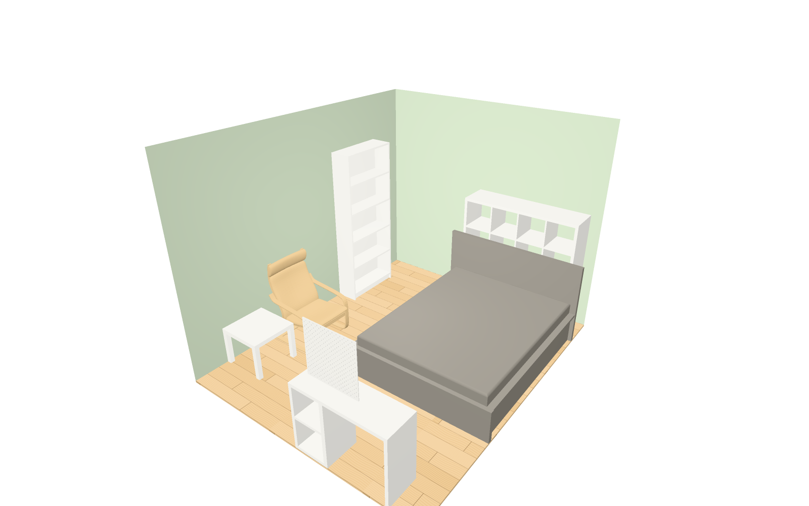
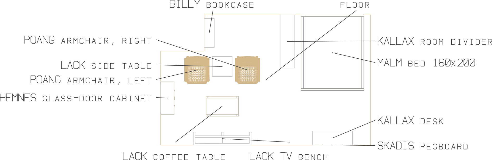
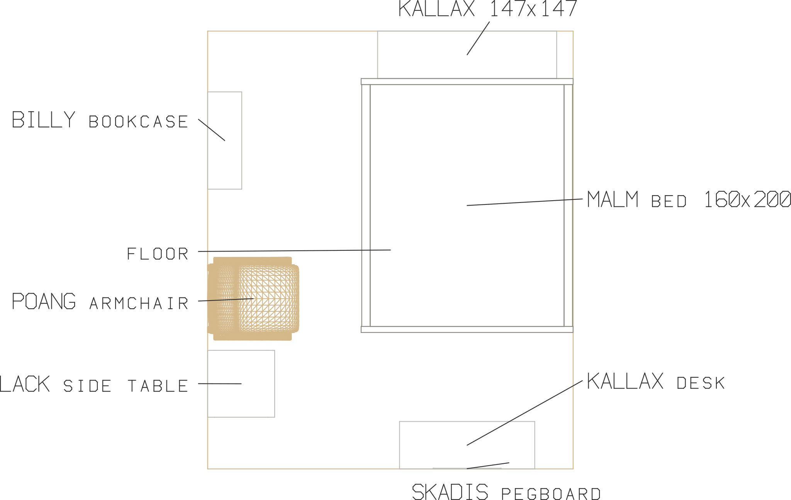

# IKEA for PartCAD

IKEA, published with the other stores as `//pub/svc/commerce/ikea`: a provider
that quotes IKEA articles at a local IKEA store, IKEA products as PartCAD parts
by IKEA's own categories, and rooms furnished with them.

| A studio divided by a KALLAX | A student room |
| --- | --- |
|  |  |
|  |  |

Both rooms are laid out after IKEA's own room ideas, furnished with this
package's products, and stand on walls PartCAD raises from a floor plan (see
[Sample rooms](#sample-rooms)) - and both are priced at a store with one
command: the studio's eleven products came to 912.93 EUR at IKEA Amsterdam on
2026-11-06 (see [Quotes at a local store](#quotes-at-a-local-store)).

**Every product is an alias of somebody's model of it.** A product is a part of
type `alias` of a model in one of PartCAD's model-site collections,
`//pub/collection/<site>` - Printables, MakerWorld, GrabCAD, Thingiverse,
Cults3D - each served by that site's repository plugin. Nothing here is IKEA's
own geometry, and no geometry is vendored: a model is fetched from its site
when it is first built.

**Only the products a model can be found of are here.** That is the rule of
this catalog, and `tools/check_catalog.py` checks it against the live sites.
It holds 27 products in 12 of IKEA's categories; 21 of them are drawn by a model
that builds without signing in anywhere.

**Every product is placed the same way**, whoever drew its model and however
they drew it: millimetres, Z up, the width along X, the middle of its back edge
at the origin on the floor, and its front facing -Y. A scene puts a product
against a wall by putting that point on the wall.

```shell
pc list packages //pub/svc/commerce/ikea/products...
pc list parts //pub/svc/commerce/ikea/products/storage-furniture/bookcases-shelving-units
pc search parts -P //pub/svc/commerce/ikea/products... -k poang
pc inspect //pub/svc/commerce/ikea/products/tables-chairs/armchairs:poang-armchair
pc render -t png --style shaded //pub/svc/commerce/ikea:studio
pc supply quote //pub/svc/commerce/ikea/products/tables-chairs/armchairs:poang-armchair#2
```

Requires PartCAD 0.9.4 or newer: the first release whose repository plugins
search their own catalog, which this one and the collections all do. See
[Status](#status) for the two PartCAD fixes 13 of the products are still waiting for.

## Quotes at a local store

The provider `//pub/svc/commerce/ikea:ikea-store` quotes IKEA articles - any
part declared with `vendor: ikea` and an IKEA article number as its `sku`,
which every product here is - at one IKEA store: the price IKEA asks in that
store's country, and whether that store sells it, off its shelf or ordered at
its desk. Every product's category names it as its supplier, so a product, a
scene or an assembly made of them is quoted there without saying so:

```text
$ pc supply quote //pub/svc/commerce/ikea/products/tables-chairs/armchairs:poang-armchair#2
INFO: The following quotes are received:
INFO:     //pub/svc/commerce/ikea:ikea-store: None: 138.00 EUR
INFO:         //pub/svc/commerce/ikea/products/tables-chairs/armchairs:poang-armchair#2

$ pc supply quote //pub/svc/commerce/ikea:studio
INFO:     //pub/svc/commerce/ikea:ikea-store: None: 912.93 EUR
INFO:         ... the eleven products of the studio
INFO: No provider found:
INFO:         //builtin/building:wall#1  ... and the floor
```

A room's walls and floor are nobody's to sell, so they are listed apart, and the
command ends with an error status for them; the quote is the furniture's.
`pc supply quote --json` adds what each line was quoted on: the article, what
IKEA calls it, how many, the price of one and of all, and the store's stock in
its words ("in stock", "only a few left", "ordered in the store").

**Which store.** IKEA Amsterdam (`088`) unless you say otherwise, by its number
or by a word of its name; a name that is not one store's is answered with the
stores there are:

```shell
pc --extra-param //pub/svc/commerce/ikea:ikea-store.store=Utrecht supply quote ...
```

```yaml
# ~/.partcad/config.yaml, for every quote
parameters:
  //pub/svc/commerce/ikea:ikea-store:
    store: Utrecht
```

| Parameter | Default | What it is |
| --- | --- | --- |
| `country` | `nl` | The store's country, as ikea.com spells it (`ikea.com/<country>/<language>/`): it decides the stores there are, the prices and their currency. |
| `language` | `en` | The language of the site the store is asked through: the names of things, not their prices. |
| `store` | `088` | The store, by its number on ikea.com or a word of its name. |
| `currency` | `EUR` | What the country prices in, which PartCAD takes the quote to be in; a quote in another is refused, saying which to set. |

A store in another country is an `enrich` of the provider:

```yaml
providers:
  ikea-berlin:
    type: enrich
    source: //pub/svc/commerce/ikea:ikea-store
    with: {country: de, language: de, store: "324"}   # IKEA Berlin-Lichtenberg
```

**Where the answers come from.** IKEA publishes no API for prices or stock.
What answers both is ikea.com's own product search, asked for the article number
at the store - what the website's search page asks, without a key - and the list
of a country's stores the website reads. The provider says what it is in its
User-Agent, keeps every answer for an hour (and the stores for a day) under
`~/.cache/partcad-ikea/` (`$PARTCAD_IKEA_CACHE`), and asks nothing else. IKEA
says how much a store has in words rather than numbers, so a store that has
some is taken to have as many as are asked for. A country that sells an article
under another number than this catalog's (Dutch) one - the United States and
Canada - does not find it, and says so. Nothing is put in a basket at ikea.com,
so a quote has no cart ID, and ordering is not implemented. Using ikea.com is
subject to IKEA's terms of use.

Run against ikea.com on 2026-11-06: the Dutch and German store lists; prices and
stock at IKEA Amsterdam, IKEA Utrecht and IKEA Berlin-Lichtenberg, plain
articles and combinations (`S...`) alike; and both rooms quoted end to end with
PartCAD.

## Categories

The packages under `//pub/svc/commerce/ikea/products` are IKEA's own categories,
named as ikea.com names them and keyed to its own keys (the `ikea:` of each in
`catalog.yaml`). A category is listed only while it holds a product:

```text
//pub/svc/commerce/ikea/products
├── storage-furniture                    st001
│   ├── bookcases-shelving-units         st002   KALLAX, LACK, BILLY, HEMNES
│   ├── tv-media-furniture               10475   KALLAX, LACK
│   └── storage-solution-systems         46052   PAX
├── beds-mattresses                      bm001
│   └── beds                             bm003   MALM
├── sofas-armchairs-footstools           700640
│   └── sofas                            fu003   KLIPPAN, SÖDERHAMN
├── tables-chairs                        fu002
│   ├── coffee-side-tables               10705   LACK
│   ├── armchairs                        fu006   POÄNG
│   └── childrens-chairs                 bc004   MAMMUT
├── desks-desk-chairs                    fu004
│   └── desks-computer-desks             20649   KALLAX, MICKE, LAGKAPTEN / ALEX
├── baby-children                        bc001
│   └── toy-storage                      20474   TROFAST
├── small-storage-organisers             st007
│   └── hooks-wall-organisation          st006   SKÅDIS
└── lighting                             li001
    └── lamps                            li002   TERTIAL
```

## Products

A part is named after what IKEA sells - `kallax-shelving-unit-147x147` - and
says what IKEA calls it, in which colour, by which article number, and whose
model it is drawn with:

```text
$ pc list parts //pub/svc/commerce/ikea/products/tables-chairs/armchairs
//pub/svc/commerce/ikea/products/tables-chairs/armchairs  poang-armchair  IKEA POÄNG Armchair, birch veneer/Knisa
    light beige (S392.407.87). Drawn with 'IKEA Poang Chair' on Printables (CC0 1.0), scaled 1000:1.
```

Each one is bought, not made: it names `vendor: ikea` and the article number as
its `sku`, and its `url` is the product's page on ikea.com. What IKEA says about
a product - its name, type, size, colour, article number and page - is from
ikea.com's own product search, for the Netherlands in English (`nl/en`): metric,
in English, and in European bed sizes.

| Category | Part | IKEA | Drawn with | Licence |
| --- | --- | --- | --- | --- |
| `storage-furniture/bookcases-shelving-units` | `kallax-shelving-unit-77x41` | [KALLAX shelving unit, 77x41 cm](https://www.ikea.com/nl/en/p/kallax-shelving-unit-white-90301555/) 903.015.55 | [Printables](https://www.printables.com/model/1787571), 25:1 | CC0 1.0 |
| `storage-furniture/bookcases-shelving-units` | `kallax-shelving-unit-77x77` | [KALLAX shelving unit, 77x77 cm](https://www.ikea.com/nl/en/p/kallax-shelving-unit-white-20275814/) 202.758.14 | [Printables](https://www.printables.com/model/1297716) (+2 more) | CC0 1.0 |
| `storage-furniture/bookcases-shelving-units` | `kallax-shelving-unit-42x147` | [KALLAX shelving unit, 42x147 cm](https://www.ikea.com/nl/en/p/kallax-shelving-unit-white-00275848/) 002.758.48 | [Printables](https://www.printables.com/model/1787571), 25:1 | CC0 1.0 |
| `storage-furniture/bookcases-shelving-units` | `kallax-shelving-unit-77x147` | [KALLAX shelving unit, 77x147 cm](https://www.ikea.com/nl/en/p/kallax-shelving-unit-white-80275887/) 802.758.87 | [Printables](https://www.printables.com/model/1787571), 25:1 | CC0 1.0 |
| `storage-furniture/bookcases-shelving-units` | `kallax-shelving-unit-112x147` | [KALLAX shelving unit, 112x147 cm](https://www.ikea.com/nl/en/p/kallax-shelving-unit-white-10409932/) 104.099.32 | [Printables](https://www.printables.com/model/1787571), 25:1 | CC0 1.0 |
| `storage-furniture/bookcases-shelving-units` | `kallax-shelving-unit-147x147` | [KALLAX shelving unit, 147x147 cm](https://www.ikea.com/nl/en/p/kallax-shelving-unit-white-30275861/) 302.758.61 | [Printables](https://www.printables.com/model/1787571), 25:1 (+1 more) | CC0 1.0 |
| `storage-furniture/bookcases-shelving-units` | `kallax-shelving-unit-182x182` | [KALLAX shelving unit, 182x182 cm](https://www.ikea.com/nl/en/p/kallax-shelving-unit-black-brown-70301542/) 703.015.42 | [Printables](https://www.printables.com/model/1787571), 25:1 (+1 more) | CC0 1.0 |
| `storage-furniture/bookcases-shelving-units` | `lack-wall-shelf-unit-30x190` | [LACK wall shelf unit, 30x190 cm](https://www.ikea.com/nl/en/p/lack-wall-shelf-unit-white-60282186/) 602.821.86 | [Printables](https://www.printables.com/model/1787409), 25:1 | CC0 1.0 |
| `storage-furniture/bookcases-shelving-units` | `billy-bookcase-80x28x202` | [BILLY bookcase, 80x28x202 cm](https://www.ikea.com/nl/en/p/billy-bookcase-white-00263850/) 002.638.50 | [Printables](https://www.printables.com/model/1335419), 12:1 | CC BY 4.0 |
| `storage-furniture/bookcases-shelving-units` | `hemnes-glass-door-cabinet-with-3-drawers-90x197` | [HEMNES glass-door cabinet with 3 drawers, 90x197 cm](https://www.ikea.com/nl/en/p/hemnes-glass-door-cabinet-with-3-drawers-white-stain-light-brown-50413507/) 504.135.07 | [Printables](https://www.printables.com/model/34773) | CC BY 4.0 |
| `storage-furniture/tv-media-furniture` | `kallax-tv-bench-147x60` | [KALLAX TV bench, 147x60 cm](https://www.ikea.com/nl/en/p/kallax-tv-bench-white-70562087/) 705.620.87 | [Printables](https://www.printables.com/model/1787571), 25:1 | CC0 1.0 |
| `storage-furniture/tv-media-furniture` | `lack-tv-bench-160x35x36` | [LACK TV bench, 160x35x36 cm](https://www.ikea.com/nl/en/p/lack-tv-bench-white-30498927/) 304.989.27 | [Printables](https://www.printables.com/model/1787409), 25:1 | CC0 1.0 |
| `storage-furniture/tv-media-furniture` | `lack-tv-bench-120x35x36` | [LACK TV bench, 120x35x36 cm](https://www.ikea.com/nl/en/p/lack-tv-bench-white-30498890/) 304.988.90 | [Printables](https://www.printables.com/model/1787409), 25:1 | CC0 1.0 |
| `storage-furniture/storage-solution-systems` | `pax-wardrobe-frame-100x58x201` | [PAX wardrobe frame, 100x58x201 cm](https://www.ikea.com/nl/en/p/pax-wardrobe-frame-white-70458203/) 704.582.03 | [GrabCAD](https://grabcad.com/library/ikea-pax-100x58x201-1), as drawn | GrabCAD's terms |
| `beds-mattresses/beds` | `malm-bed-frame-high-160x200` | [MALM bed frame, high, 160x200 cm](https://www.ikea.com/nl/en/p/malm-bed-frame-high-grey-stained-luroy-s69385793/) S693.857.93 | [MakerWorld](https://makerworld.com/en/models/2240785), 22.6:1 | Standard Digital File License |
| `sofas-armchairs-footstools/sofas` | `klippan-2-seat-sofa` | [KLIPPAN 2-seat sofa](https://www.ikea.com/nl/en/p/klippan-2-seat-sofa-vissle-grey-s79010614/) S790.106.14 | [GrabCAD](https://grabcad.com/library/ikea-klippan-sofa), as drawn | GrabCAD's terms |
| `sofas-armchairs-footstools/sofas` | `soderhamn-3-seat-section` | [SÖDERHAMN 3-seat section](https://www.ikea.com/nl/en/p/soderhamn-3-seat-section-kelinge-beige-s49621606/) S496.216.06 | [GrabCAD](https://grabcad.com/library/ikea-soderhamn-1), as drawn | GrabCAD's terms |
| `tables-chairs/coffee-side-tables` | `lack-side-table-55x55` | [LACK side table, 55x55 cm](https://www.ikea.com/nl/en/p/lack-side-table-white-30449908/) 304.499.08 | [Printables](https://www.printables.com/model/320128) (+1 more) | CC0 1.0 |
| `tables-chairs/coffee-side-tables` | `lack-coffee-table-90x55` | [LACK coffee table, 90x55 cm](https://www.ikea.com/nl/en/p/lack-coffee-table-white-stained-oak-effect-50319029/) 503.190.29 | [Printables](https://www.printables.com/model/1787409), 25:1 | CC0 1.0 |
| `tables-chairs/armchairs` | `poang-armchair` | [POÄNG armchair](https://www.ikea.com/nl/en/p/poang-armchair-birch-veneer-knisa-light-beige-s39240787/) S392.407.87 | [Printables](https://www.printables.com/model/290635), 1000:1 | CC0 1.0 |
| `tables-chairs/childrens-chairs` | `mammut-childrens-stool` | [MAMMUT children's stool](https://www.ikea.com/nl/en/p/mammut-childrens-stool-in-outdoor-red-70581991/) 705.819.91 | [Printables](https://www.printables.com/model/168889) | CC BY-SA 4.0 |
| `desks-desk-chairs/desks-computer-desks` | `kallax-desk-111x39` | [KALLAX desk, 111x39 cm](https://www.ikea.com/nl/en/p/kallax-desk-white-30582445/) 305.824.45 | [Printables](https://www.printables.com/model/1787571), 25:1 | CC0 1.0 |
| `desks-desk-chairs/desks-computer-desks` | `micke-desk-105x50` | [MICKE desk, 105x50 cm](https://www.ikea.com/nl/en/p/micke-desk-white-80213074/) 802.130.74 | [GrabCAD](https://grabcad.com/library/micke-ikea-desk-1), as drawn | GrabCAD's terms |
| `desks-desk-chairs/desks-computer-desks` | `lagkapten-alex-desk-140x60` | [LAGKAPTEN / ALEX desk, 140x60 cm](https://www.ikea.com/nl/en/p/lagkapten-alex-desk-white-s99431982/) S994.319.82 | [GrabCAD](https://grabcad.com/library/ikea-lagkapten-desk-1), as drawn | GrabCAD's terms |
| `baby-children/toy-storage` | `trofast-storage-combination-with-boxes-99x44x56` | [TROFAST storage combination with boxes, 99x44x56 cm](https://www.ikea.com/nl/en/p/trofast-storage-combination-with-boxes-white-white-s59574459/) S595.744.59 | [Printables](https://www.printables.com/model/589331), 12:1 | CC BY 4.0 |
| `small-storage-organisers/hooks-wall-organisation` | `skadis-pegboard-56x56` | [SKÅDIS pegboard, 56x56 cm](https://www.ikea.com/nl/en/p/skadis-pegboard-white-00320803/) 003.208.03 | [Printables](https://www.printables.com/model/1601739) | CC0 1.0 |
| `lighting/lamps` | `tertial-work-lamp` | [TERTIAL work lamp](https://www.ikea.com/nl/en/p/tertial-work-lamp-dark-grey-50355395/) 503.553.95 | [GrabCAD](https://grabcad.com/library/ikea-tertial-work-lamp-1), as drawn | GrabCAD's terms |

"25:1" is a scale model (here, interior-design miniatures at 1:25 and dollhouse
models at 1:12) drawn at full size; "as drawn" is a GrabCAD model, which is served
exactly as its designer drew it - see [Placement](#placement).

## Search

Every category that holds products searches them itself (`searchKinds`), so ask
it of the whole tree with `...`:

```shell
pc search parts -P //pub/svc/commerce/ikea/products... -k poang          # POÄNG, without its diacritics
pc search parts -P //pub/svc/commerce/ikea/products... -k 302.758.61     # an article number, with or without its dots
pc search parts -P //pub/svc/commerce/ikea/products... -k "kallax 147"   # every word has to be found
pc search parts -P //pub/svc/commerce/ikea/products... -k couch          # finds the sofas: another word for them
```

A search compares words, in lower case and without diacritics: the part's name,
IKEA's name, type, size, colour and article number of the product, the names of
the categories it is in, and a few keywords of its own (`keywords:` in
`catalog.yaml`). Every word of the query has to be found, as a word, as another
word for the same thing (sofa, couch, settee; bookcase, bookshelf, shelving; ...)
or inside one - `kall` finds KALLAX, `3027586` its article number. Products named
by the word come first.

## Sources: which model a product is drawn with

Several products have more than one model, and the plugin's `sources` parameter
says which sites to draw them with, best first: a product is drawn with its
model on the first of those that has one, and a **product none of them has a
model of is not served at all** - it is not listed, found or searched.

| `sources` | What you get |
| --- | --- |
| `printables,makerworld,grabcad,thingiverse,cults3d` (the default) | Every product. The six GrabCAD ones build only with a GrabCAD sign-in (`pc login //pub/collection/grabcad:grabcad_repo`). |
| `printables,makerworld` | The 21 products that build without signing in anywhere. |
| `grabcad,printables,makerworld` | GrabCAD's full CAD models first, where there are some, for those who have signed in. |

Set it in your own `~/.partcad/config.yaml`, by the plugin's name:

```yaml
parameters:
  //pub/svc/commerce/ikea:ikea_repo:
    sources: printables,makerworld
```

or with an `enrich` of the plugin in a package of your own, whose products are
then yours to name - `//my_ikea/<category>:<product>` in a package at the root:

```yaml
repositories:
  my_ikea_repo:
    type: enrich
    source: //pub/svc/commerce/ikea:ikea_repo
    with:
      sources: printables,makerworld
dependencies:
  my_ikea:
    type: external
    plugin: :my_ikea_repo
```

## Placement

What a model site holds is whatever its designer drew: a scale model lying on its
back to be 3D-printed, a cabinet hanging from its top, a chair in metres. Each
product's alias brings its model to one convention - millimetres, Z up, the width
along X, the middle of its back edge at the origin on the floor, the front facing
-Y - with the `offset` and `scale` PartCAD applies to any reference (a rotation
about the origin then a translation, in the model's own units, and then the
scale). So in a scene:

```yaml
links:
  # Against the back wall (y = 3600), facing into the room.
  - part: //pub/svc/commerce/ikea/products/beds-mattresses/beds:malm-bed-frame-high-160x200
    location: [[4745, 3600, 0], [0, 0, 1], 0]
  # Against the front wall (y = 0): turned 180.
  - part: //pub/svc/commerce/ikea/products/desks-desk-chairs/desks-computer-desks:kallax-desk-111x39
    location: [[4745, 0, 0], [0, 0, 1], 180]
  # Against the left wall (x = 0): turned 90.
  - part: //pub/svc/commerce/ikea/products/storage-furniture/bookcases-shelving-units:billy-bookcase-80x28x202
    location: [[0, 2700, 0], [0, 0, 1], 90]
```

The offsets are worked out from each model's bounding box by
`tools/fit_offset.py`, and every product placed so (`placed: measured` in
`catalog.yaml`) was built and checked with `pc info`: its box runs from
`[-width/2, -depth, 0]` to `[width/2, 0, height]`. A GrabCAD model takes a
GrabCAD sign-in to fetch, so the six that only GrabCAD has could not be measured,
and are served as their designers drew them (`placed: as-drawn`).

A product's colour is its model's; a scene paints it with IKEA's, by naming one
of the colours this package declares (`:white`, `:birch-veneer`, ...) on the link,
with `sourceCmf: drop` so that the model's own colour gives way:

```yaml
    params: {color: "//pub/svc/commerce/ikea:white", sourceCmf: drop}
```

## Sample rooms

Two scenes, each a room standing on a floor plan, furnished after one of IKEA's
own room ideas with the products of this package:

- **`//pub/svc/commerce/ikea:studio`**, an 18 m² studio after IKEA's
  [Decorating a small room](https://www.ikea.com/nl/en/ideas/decorating-a-small-room-pub1a05ea50/):
  "The seating area is separated from the sleeping area by a KALLAX shelf unit."
  A KALLAX 147x147 stands out from the back wall between a MALM bed and the
  seating area; a sofa stands near a HEMNES glass-door cabinet; a desk is under
  a SKÅDIS pegboard; a BILLY fills the alcove beside the bathroom block.
- **`//pub/svc/commerce/ikea:student-room`**, a 10.8 m² room after IKEA's
  [How to furnish a small student room](https://www.ikea.com/nl/en/ideas/furnish-small-student-room-pub6cb73390/):
  a KALLAX 147x147 "by the head end of a bed", a KALLAX desk "by the foot end of
  a bed", SKÅDIS on the wall, and a reading corner.

IKEA's pages show the rooms and name the products; they give no dimensions, so
the rooms' sizes and the products' places are this package's. Where a page's
product is drawn by no model in the collections, or only by one that takes a
sign-in, the nearest product that is stands in for it, and the scene says so:
POÄNG armchairs for the studio's sofas, a KALLAX desk for its MICKE (on GrabCAD),
a MALM bed for the student room's BRIMNES and a POÄNG for its LOBERGET chair.

What they are made of is PartCAD's own:

- **Rooms from a plan.** `floorplans/*.dxf` is each room's outline, written by
  `tools/draw_floorplans.py`. A `walls` scene - an `enrich` of
  `//builtin/building:room` - stands a wall on every edge of it, every one looking
  into the room and see-through from behind, which is why the pictures look into
  the rooms through their near walls, as a dollhouse does.
- **The floor is the plan too**, extruded 20 mm (`type: extrude`).
- **Colours.** The walls are painted by the room's `color`, the products by each
  link's `params`, all of them display-only colour declarations of this package;
  the floor is a texture, `textures/oak-floor.png`, drawn by
  `tools/draw_textures.py`, laid 1.2 m to a copy.
- **Shaded pictures**: `pc render -t png` with `style: shaded`, as the IDE's 3D view
  draws them, configured in `partcad.yaml`.
- **Plans with callouts**: `pc render -t svg --view top --with-component-names`,
  every product named by its link, and `--filter scenes/<room>.plan.yaml` to leave
  the walls out of the callouts.

`tools/render_readme.sh` draws all four pictures again. Every model the rooms use
builds without a sign-in.

## Status

`tools/check_catalog.py` asks ikea.com's product search and the model sites
again, and says what no longer agrees: an article IKEA no longer finds, or calls
by another name, a model or a file a site no longer has. Run on 2026-11-05: every
article found under the name given here, and every model and file found on its
site. Thingiverse and Cults3D take credentials to ask anything, so the catalog
has no model on either yet; the plugin takes them as sources all the same.

With PartCAD as of this package, built and placed with `pc info` and drawn with
`pc render`: every product that builds without a sign-in. Not built, for want of
a GrabCAD sign-in: the six GrabCAD products, whose files are only listed.

13 of the products need two PartCAD fixes that are not in a release yet
(`partcad/partcad`, branch `claude/ikea-external-repo-setup-3qhqff`):

- The 1:25 KALLAX and LACK models are 3MF files that colour their object with a
  materials-extension colour group, which PartCAD 0.9.4 fails to read
  (`Lib3MFException 5: unknown error`). That is 12 products, and both rooms.
- TROFAST's model is an ASCII STL, which PartCAD 0.9.4 reads as a mesh with no
  surface and then neither moves nor scales: the product comes out at 1:12 where
  its model lies.

`partcad:` here goes up to the release that carries them.

## Publishing

This package goes into the PartCAD index as `//pub/svc/commerce/ikea`, with the
other stores, once the model-site collections it aliases are at
`//pub/collection` there. In `svc/commerce/partcad.yaml` of
`partcad/partcad-index`:

```yaml
  ikea:
    desc: IKEA, quoted at a local store; and its products, by IKEA's categories
    type: git
    url: https://github.com/partcad/partcad-repo-ikea
    track: main
    revision: <the commit main is at>
```

## Layout

| Path | Purpose |
| --- | --- |
| `partcad.yaml` | `//pub/svc/commerce/ikea`: the `ikea-store` provider; the `products` external dependency and the `ikea_repo` repository that serves it; the colours, floor plans, floors and rooms of the samples. |
| `ikea_store.py` | The provider: quotes IKEA articles at one IKEA store, from ikea.com's own search. |
| `catalog.yaml` | The products: IKEA's categories, what IKEA sells, and the models each is drawn with and how they are placed. |
| `ikea_repo.py` | The repository plugin: serves the catalog as packages and aliases, and searches it. |
| `scenes/` | The sample rooms (`*.assy`) and what their plans keep (`*.plan.yaml`). |
| `floorplans/`, `textures/`, `images/` | The rooms' outlines, the floor's texture, and the pictures above. |
| `tools/` | `check_catalog.py`, `fit_offset.py`, `draw_floorplans.py`, `draw_textures.py`, `render_readme.sh`. |
| `test_ikea_repo.py`, `test_ikea_store.py` | The tests. Nothing in them touches the network. |

```shell
python -m pytest
```

When what the plugin answers changes - here or in `catalog.yaml` - raise
`CACHE_VERSION` in `ikea_repo.py`: PartCAD keys everything it caches of this
package on it.

To add a product: find a model of it on one of the sites (`pc search parts -P
//pub/collection/printables/models -k "ikea <name>"`), take what IKEA says of it
from ikea.com, add it to `catalog.yaml` under its IKEA category, fit its offset
with `tools/fit_offset.py` from `pc info` of the model, check the product's box
with `pc info` of it, and run `tools/check_catalog.py` and the tests.

## Licensing

The code, the catalog, the floor plans, the texture and the pictures here are
Apache-2.0 (`LICENSE`). Each model is its designer's, under the licence its site
states and the table above repeats; a GrabCAD model is under GrabCAD's terms of
use. IKEA and the names of its products are IKEA's, and ikea.com is subject to
IKEA's terms of use; this package is not affiliated with or endorsed by IKEA,
nor by any of the model sites.
